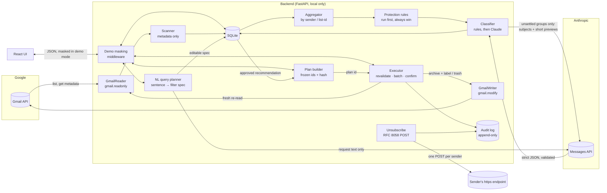

# Sift architecture

Sift is two local processes: a FastAPI backend (127.0.0.1:8765) and a React UI (127.0.0.1:5173). The backend
owns all data (SQLite, one database per mailbox) and all external calls. Two components use Claude; everything
that decides what happens to mail is plain, tested code.

## The pipeline
1. **Scanner** (`scanner.py`): `messages.list` per label, then batched `messages.get(format=metadata)`. It never
   fetches bodies and never marks mail read. It checkpoints after every page, so a 6-hour scan survives a restart.
2. **Aggregator** (`analysis.py`): groups by sender address, domain and `List-Id`, with counts, date ranges,
   unread share and Gmail category tabs.
3. **Protection** (`protection.py`): deterministic rules, applied before any classifier: starred, threads with your
   reply, senders you've emailed (To/Cc/Bcc), receipt/order/travel/security/finance subject patterns, and your own
   sender/domain/label rules. Gmail's IMPORTANT label and the presence of `List-Unsubscribe` are deliberately not
   decisive. Flags are re-derived when the built-in rules change.
4. **Classifier** (`classifier/`): rules first. Groups the rules can't settle go to Claude: Haiku for the first
   pass, Opus for a second opinion on low-confidence groups. Input is an escaped JSON data block marked untrusted,
   Claude gets no tools, and output must match a strict schema or the whole batch is rejected. Labels are cached
   per sender. Every call is recorded in a spend ledger; each request reserves its worst-case cost against the
   run's cap before it is sent.
5. **Natural-language planner** (`ai/planner.py`, `query.py`): turns a sentence into a structured filter spec (not
   SQL). The UI shows the spec and the local match count; you edit it and save it as a recommendation.
6. **Plan builder** (`plans.py`): resolves approved recommendations to exact message ids at that moment and stores
   them with a hash. Approval requires echoing the hash. SQLite triggers block adding, removing or changing rows
   after draft, re-approval, and reviving cancelled plans. A plan built from an older analysis (new scan, rule
   change, Claude run) is refused at run time.
7. **Executor** (`executor.py`): the only code that holds a write-capable client, and it accepts only a plan id.
   Per chunk of at most 500 it re-reads each message and drops anything that no longer exists, has left the Inbox,
   is in Trash, is newly protected (including mail you sent since the scan), or no longer matches. It writes an
   `attempted` audit row, calls `batchModify` (archive = remove INBOX, add the run label) or `trash`, re-reads to
   confirm, and records `confirmed` or `failed`. Restore follows the audit log, so it also undoes changes that were
   attempted but never confirmed.
8. **First-run gate**: until unlocked, a run takes exactly one recommendation and is capped at 50 messages; unlock
   requires a completed restore of every change that run attempted. Disconnecting or switching account resets it.
9. **Unsubscribe** (`unsubscribe.py`): only when both RFC 8058 headers are present and exact. Batches are frozen and
   approved separately. The POST goes to a vetted public HTTPS host, pinned to the resolved IP, with TLS hostname
   checks, no redirects and no cookies. The log keeps the host only, never the tokenised URL.

## Trust boundaries
| Boundary | Rule |
|---|---|
| Browser → API | Local Host required; state-changing requests need the `X-Sift` header and a local Origin (blocks other sites and DNS rebinding). |
| Email content → Claude | Untrusted data in an escaped block; minimal samples; protected mail never sent; no tools. |
| Claude → Sift | Data, never instructions: schema-validated, and it can't touch protection, plans or execution. |
| Sift → Gmail | Reader token is read-only. Writer token (separate Keychain item) is used only by the executor. No delete or send calls exist. |
| Sift → the web | Only approved RFC 8058 POSTs. No links followed, no attachments opened. |
| Secrets | OAuth tokens in the macOS Keychain; never logged or sent to the UI. The API key stays in `.env`. |

## Data
One SQLite database per mailbox (`data/sift.sqlite` synthetic, `data/sift-gmail.sqlite` real), directory 0700 and
files 0600. Main tables: `scans`, `messages` (metadata only), `sender_groups`, `recommendations`, `ai_labels`,
`ai_runs`, `ai_usage`, `plans`, `plan_messages`, `runs`, `audit_log`, `unsubscribe_batches`, `unsubscribe_log`.
`audit_log` and `unsubscribe_log` are append-only by trigger.

## Extending
`MailReader`/`MailWriter` (`providers/base.py`) are the provider interface; an Outlook provider would implement the
same methods. Nothing outside `providers/` knows it is talking to Gmail.
